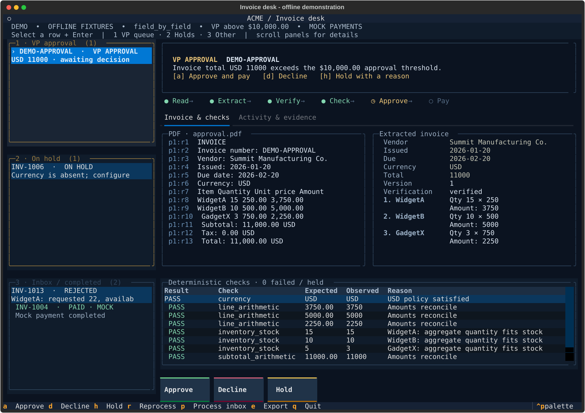
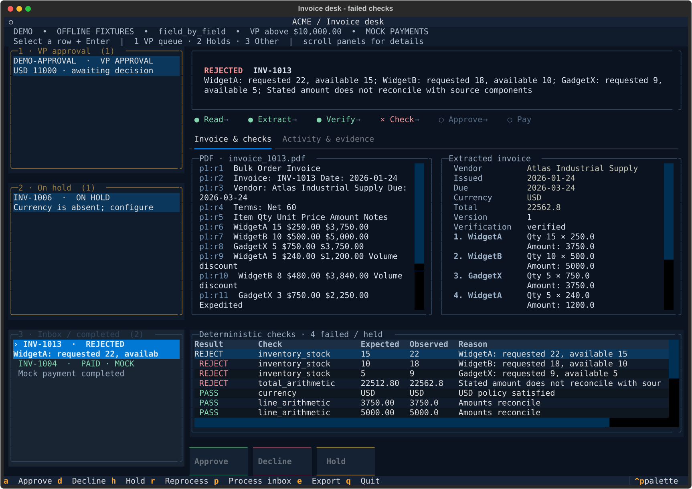
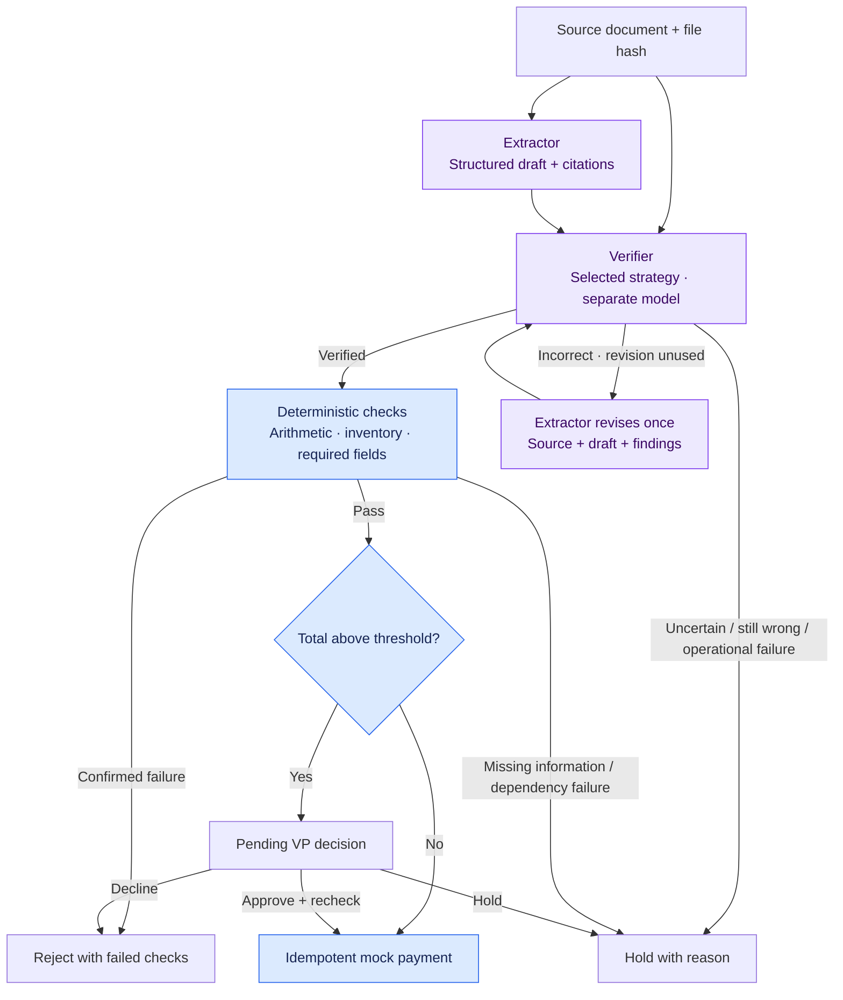
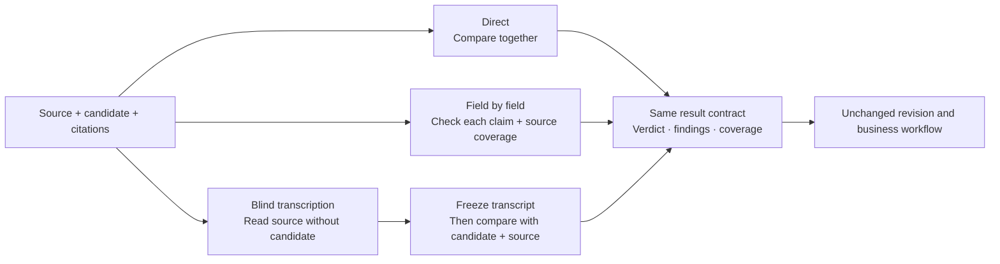
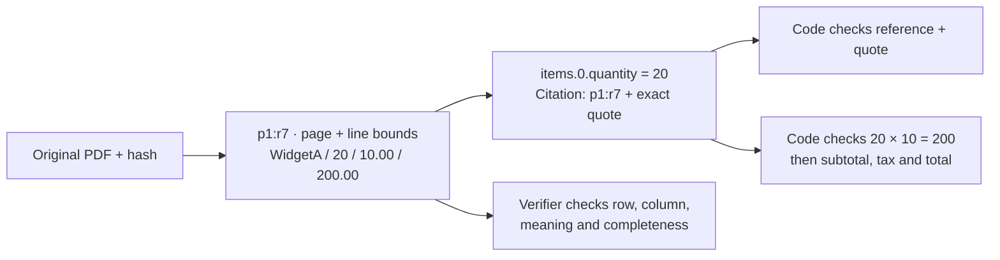

# Invoice desk

A local invoice-processing system that turns source documents into cited, verified drafts,
runs deterministic business checks, and routes invoices to approval, rejection, or hold.
The terminal interface shows the source, extracted fields, failed checks, and decision history.

**Two model roles: extract and verify. One revision maximum. Code handles business decisions.**
Live models are supported; inventory is a local SQLite snapshot, VP decisions happen in the
interface, and payments are simulated. The [original case brief](docs/CASE_BRIEF.md) is preserved separately.

  
_Offline fixture results do not measure model accuracy._

[Run it](#run-it) · [How it works](#how-it-works) · [Evaluation and results](#evaluation-and-results) · [Assumptions and improvements](#assumptions-and-improvements)

## Run it

Requires Python 3.11+ and `uv`. Start with the offline demo; no API key or network is needed:

```bash
uv sync
uv run python scripts/setup_db.py
uv run python main.py --demo
```

The demo processes four supplied invoices: a PDF awaiting VP approval, a PDF rejected for
stock/arithmetic failures, a CSV held for missing currency, and a JSON invoice mock-paid.
The approval example is an $11,000 PDF whose quantities fit the standard inventory.
Each demo launch gets a fresh state database. The inventory setup preserves existing stock.

### Process your own invoices

Copy [.env.example](.env.example) to `.env` if you have not configured it yet. Set
`XAI_API_KEY`, `EXTRACTOR_MODEL`, and `VERIFIER_MODEL`. Choose distinct model IDs; PDF
verification requires image support. The TUI loads `.env`; existing shell variables take precedence.

Drop PDFs, TXT, JSON, CSV, or XML files into `data/inbox/`, then run:

```bash
uv run python main.py
# Or choose a folder or individual files:
uv run python main.py --inbox /path/to/invoices
uv run python main.py one.pdf two.pdf
```

Normal startup uses **live models** and processes the inbox automatically.  
The inbox scan covers immediate files, not subfolders; press `p` to pick up newly added files. Unchanged inputs with the same processing configuration reuse saved results. `--no-autorun` opens the desk without starting work.

| Key                    | Action                                                          |
| ---------------------- | --------------------------------------------------------------- |
| Arrows + Enter / click | Select an invoice                                               |
| `1` / `2` / `3`        | Focus VP / hold / inbox and completed queues                    |
| `a` / `d`              | Approve and mock-pay / decline a pending VP invoice             |
| `h`                    | Hold a pending VP invoice with a required reason                |
| `r`                    | Reprocess the selected invoice                                  |
| `p` / `f`              | Rescan and process / resume following the active invoice        |
| `e` / `q`              | Export selected result to JSON / quit after processing finishes |

Approval uses the persisted draft, rechecks source identity and current inventory, and creates
an idempotent mock receipt. Held or rejected invoices cannot bypass validation with `a`.
The normal TUI state lives in `runs/tui.db`; `--state-db` selects another database.
A 120×40 terminal is recommended; smaller terminals use a compact layout. Unset `NO_COLOR`
for colored output.

See failed checks in the interface



JSON CLI, configuration, and saved state

Supplying `--invoice_path` selects the JSON CLI, which defaults to **offline fixtures**:

```bash
uv run python main.py --invoice_path data/invoices/invoice_1001.txt
uv run python main.py --invoice_path data/invoices/invoice_1002.txt --output runs/result.json
uv run python main.py --invoice_path data/invoices/invoice_1006.csv --default-currency USD
```

For live CLI runs, export credentials/model IDs in your shell; unlike the TUI and evaluation
commands, the JSON CLI does not load `.env` itself:

```bash
uv run python main.py --invoice_path data/invoices/invoice_1011.pdf \
  --mode live --extractor-model "$EXTRACTOR_MODEL" --verifier-model "$VERIFIER_MODEL" \
  --strategy blind_transcription
```

`--strategy` selects `direct`, `field_by_field` (default), `blind_transcription`,
`blind_extraction`, or `batched_claims` in either interface. `--approval-threshold` changes the VP threshold. In the JSON CLI, `--vp approve`
or `--vp decline` supplies a simulated decision on a rerun; otherwise it remains pending.
`--default-currency USD` is an explicit business assumption, not source evidence.

Stdout contains complete JSON; stderr contains stage events (`--quiet` suppresses them).
Exit code 0 means paid or duplicate; 2 means rejected, held, pending, or invalid configuration.
CLI state defaults to `runs/workflow.db`. Databases retain source regions, draft versions,
verification artifacts, checks, decisions, receipts, and audit events. Inbox files, credentials,
and run artifacts are ignored by Git.

The adapter uses Chat Completions-compatible endpoints. xAI/OpenAI use JSON mode with local
Pydantic validation; Anthropic compatibility uses strict JSON schema. Configure provider URLs
and key-environment names through the options in `.env.example` or `--verifier-url` and
`--verifier-key-env`. There is no silent model fallback. Use `--help` for all CLI options.

Offline mode recognizes only source-hash-bound demo fixtures. New or modified documents
require live models or a reviewed fixture. All three offline strategies use a deterministic
oracle, so their scores cannot rank live strategies.

## How it works



The verifier asks **“does this draft faithfully represent the source?”** It has no inventory,
approval, or payment tools and never outputs a corrected invoice. The extractor owns corrections.
Once source fidelity is established, code can explain each failed business rule without another
reviewer agent. A correctly extracted order for 20 units still gets rejected if stock is 5.

This implements the brief's self-correction goal at extraction. Approval is deliberately a
rule plus a human decision, rather than the brief's proposed approval-agent critique loop.

### Interchangeable verification



| Strategy              | Model behavior                                                                                                                                 |
| --------------------- | ---------------------------------------------------------------------------------------------------------------------------------------------- |
| `direct`              | Compare the full candidate, citations, and source in one assessment                                                                            |
| `field_by_field`      | Ask whether each named field/row has the proposed value; then separately check omissions and duplicates                                        |
| `blind_transcription` | Transcribe each source page without candidate values or citations; freeze the observations, then compare against the draft and original source |

Two additional experimental strategies use the same contract:

- `blind_extraction`: source-only structured extraction, followed by a deterministic comparison
  of values and citation regions. Different citation locations remain unresolved rather than
  being silently accepted. Alternative valid mappings can cause false holds.
- `batched_claims`: all field claims and a source-completeness check in one model response,
  with exact field coverage and evidence validation in code.

New strategies register in `STRATEGY_METHODS` in `invoices/verification.py`; extraction,
revision routing, business checks, and payment need no strategy-specific changes. The CLI
exposes registered strategies automatically. Comparison defaults retain the original three;
new methods must be selected explicitly to avoid silently increasing experiment size.

A field question includes meaning and row identity: “For this line item, is the quantity 20?”
This is intentionally candidate-aware; mapping context does not eliminate anchoring. Blind
transcription hides candidate values during reading, but its transcript can still be wrong.
Neither a second model nor a different presentation guarantees independent errors.

All strategies implement `verify(VerificationRequest) -> VerificationResult`. Results identify
the source and draft hashes, verdict (`verified`, `incorrect`, `uncertain`), findings, checked
fields, covered regions, and run metadata. Positive results must include complete coverage and
valid citations. Code checks that these records exist; it cannot prove their semantic truth.

### Evidence and arithmetic



PDF evidence uses `pdfplumber` **line regions** with page coordinates, not token IDs. Text formats
use line regions; JSON is pretty-printed first. Extractors receive source text; PDF verifiers also
receive page images, with focused crops for field checks. A field has one citation in the current
schema. Quotes establish provenance; model verification checks whether the cited value means
what the field claims.

Arithmetic uses `Decimal`, explicit line discounts, subtotal comparisons, tax when its base is
supported, and total reconciliation. Missing independent comparison values are marked unavailable.
Consistently wrong quantities, prices, and totals can still balance, which is why arithmetic
complements source verification.

### Long documents and implementation

The application has no document page-count/file-byte cutoff or default output-token cap.
It tries full-source requests first; blind transcription reads pages independently. Recognized
provider capacity errors and output truncation split work, preferring pages, then regions,
then text within a region. Code merges extraction results and requires global verification coverage.
Conflicting scalar values or an irreducible failure hold processing; partial work cannot authorize payment.

Optional `MODEL_CHUNK_SOURCE_BYTES`, `MODEL_CHUNK_PAGES`, `MODEL_REQUEST_BYTES`,
`MODEL_REQUEST_IMAGES`, `MODEL_OUTPUT_TOKENS`, and `--max-model-calls` are explicit overrides.
The old byte-based `MODEL_CONTEXT_TOKENS` estimate is retired and must be unset.
Provider defaults and hard limits still apply. The first oversized request may reach the provider.

Functional support and accuracy are separate: processing a long PDF does not establish that its
cross-page relationships were understood. The [capacity investigation](evals/chunk-budget-investigation.md)
records the removed estimates, provider documentation, and a live 50-page probe.

| Implementation                                                       | Location                                                                                                                                             |
| -------------------------------------------------------------------- | ---------------------------------------------------------------------------------------------------------------------------------------------------- |
| Textual interface and custom Python workflow                         | [tui.py](invoices/tui.py), [pipeline.py](invoices/pipeline.py)                                                                                       |
| Source regions, PDF views, adaptive chunking                         | [source.py](invoices/source.py), [chunking.py](invoices/chunking.py)                                                                                 |
| Pydantic contracts, extractor, verifier strategies, provider adapter | [models.py](invoices/models.py), [agents.py](invoices/agents.py), [verification.py](invoices/verification.py), [providers.py](invoices/providers.py) |
| Business rules and SQLite audit/idempotent receipts                  | [rules.py](invoices/rules.py), [store.py](invoices/store.py)                                                                                         |

## Evaluation and results

**Positive means accepting the extraction, not approving payment.** TPR is correct drafts
accepted ÷ all correct drafts; FPR is corrupted drafts accepted ÷ all corrupted drafts.
Uncertainty and operational errors stay in these denominators and are reported separately.
An accurately extracted but commercially invalid invoice is a correct extraction.

### Completed initial comparison

The [initial live evaluation](evals/live-results-2026-10-31.md) ran three strategies across
Grok 4.20 non-reasoning, GPT-4.1 mini, and Claude Haiku 4.5: 162 trials based on **only three
source documents**. Combined across models:

| Strategy            | Correct drafts accepted (TPR) | Corrupted drafts accepted (FPR) | Median seconds |
| ------------------- | ----------------------------: | ------------------------------: | -------------: |
| Direct              |                           7/9 |                            0/45 |            2.6 |
| Field by field      |                           6/9 |                            0/45 |           18.0 |
| Blind transcription |                           9/9 |                            0/45 |            5.4 |

Blind transcription led this small development experiment, especially at avoiding unnecessary
holds. These results used older prompts and capacity settings; they do not establish the best
current strategy. The application default remains field-by-field while alternatives are evaluated.

### Small budget comparison

A subsequent [24-case comparison](evals/small-strategy-results-2026-10-31.md) covered all eight
development layout families and completed in **95 model calls**, under an explicit 100-call cap.

| Strategy | Clean accepted | Corrupted accepted | Errors | Calls |
|---|---:|---:|---:|---:|
| Blind transcription | 7/8 | 2/16 | 1 | 47 |
| Blind structured extraction | 4/8 | 0/16 | 10 | 24 |
| Batched field claims | 0/8 | 0/16 | 1 | 24 |

The new methods are experimental: structured extraction often failed the citation schema,
while batched claims falsely flagged titles and other non-output text as omissions. Neither
improved on the baseline's balance of acceptance and errors. This small synthetic comparison
is diagnostic, not a production accuracy estimate; no strategy default was changed.

### Expanded synthetic dataset

[Mock dataset v1](evals/mock-v1/README.md) is generated from structured truth before PDF rendering,
with source-backed reference citations and controlled candidate mutations.

| Split         | Layout families | Source PDFs | Clean drafts | Corrupted drafts |
| ------------- | --------------: | ----------: | -----------: | ---------------: |
| Development   |               8 |          40 |           80 |              480 |
| Held-out test |               4 |          20 |           40 |              240 |

The 60 PDFs contain 104 pages and 840 drafts. Layouts include reordered columns, wrapped names,
repeated headers, item blocks, and multi-page summaries. Twelve error types cover wrong values,
swapped columns/rows, omissions, duplicates, citations, and mutually consistent wrong arithmetic.
Each source also has a clean numeric-format variant. Variants and shared template components are
correlated; 840 drafts are not 840 independent invoices. There are no scans or real extractor errors.

**Expanded comparison status (2026-10-31): stopped to limit API spending.**
The planned 1,680-trial development comparison stopped with 289 saved outcomes, including
94 cases completed across all three strategies (seven documents, two layout families).
This partial, file-ordered sample does not represent the full dataset. The held-out set is unused.
The network-interrupted original is preserved in `runs/mock-v1-dev-grok/results-v2/`;
recovery attempts and `partial-summary.json` are under `runs/mock-v1-dev-grok/results-recovery-v1/`.
See the [partial results and recorded usage](evals/mock-v1-partial-2026-10-31.md).

To repeat the small comparison with an explicit 100-call budget in a new output directory:

```bash
uv run python scripts/compare_verifiers.py \
  --cases evals/small-strategy-cases.json --split dev --providers grok \
  --strategies blind_transcription blind_extraction batched_claims \
  --max-total-model-calls 100 --workers 3 --output runs/my-small-comparison
```

Provider keys come from `.env` or the shell. The runner pins model IDs in
[scripts/compare_verifiers.py](scripts/compare_verifiers.py), records case/source/code hashes,
and saves each completed trial and raw response. `--providers`, `--strategies`, and an optional
`--max-model-calls` control the comparison. Field-by-field makes many requests per invoice;
full comparisons can take hours. Without `--cases`, the runner uses the original three-document set.

For network recovery, use the same cases, providers and strategies with
`--resume-from <previous-run-directory> --retry-network-errors --output <new-directory>`.
The runner checks case/source and verifier-code identity, retains completed verdicts and
validation failures, and pauses/retries connection failures until connectivity returns.
Original records remain unchanged; `attempts.jsonl` and separate trial files retain every new
attempt. The recovery summary includes new failed-attempt overhead separately; the original
run retains its own usage. Recovered accuracy outcomes are not first-attempt reliability scores.

For an explicit experiment-wide cap, pass `--max-total-model-calls N`. This shared,
thread-safe limit counts model requests across all trials and retries in that invocation;
failed requests consume budget too. It differs from the per-model/per-trial `--max-model-calls`.
When exhausted, subsequent requests fail locally before network dispatch. The manifest records
the limit and the completed summary records usage. It is a call cap, not an exact dollar cap.

Reports include error-type and family breakdowns, acceptance precision, explicit error detection,
false accusations, abstentions, operational failures, field precision/recall, latency, calls,
and token usage. Paired comparisons and intervals resample by document and by family. Monetary
cost is not guessed. With only four held-out families, uncertainty estimates remain limited.

Freeze prompts and model choices before using `test-cases.json` with `--split test`. Keep real
extractor errors separate from planted errors; synthetic precision does not estimate deployment
precision. Zero observed false accepts does not establish zero risk. Dataset generation, integrity
checks, and held-out run commands are in the [dataset reference](evals/mock-v1/README.md).

Offline harness checks, repeats, and the revision loop

```bash
# Original fixtures only: routing/metric smoke test, not model accuracy.
uv run python -m invoices.evaluation --split dev --with-revision

# Live evaluation supports repeats and a separate revision experiment.
uv run python -m invoices.evaluation --mode live \
  --cases evals/mock-v1/dev-cases.json --split dev --limit 6 --repeats 2 \
  --extractor-model "$EXTRACTOR_MODEL" --verifier-model "$VERIFIER_MODEL" \
  --output runs/repeated-evaluation.json
```

Add `--with-revision` to evaluate the one-revision loop; the multi-provider comparison above
isolates verification and does not run extraction or revision. Revision scoring uses normalized
field equality and reference citation regions; alternative valid mappings need adjudication.
`--limit` takes cases in file order and is useful for wiring checks, not representative sampling.
Ambiguous cases (`correct: null`) are reported outside binary TPR/FPR denominators. Undefined
metrics return no value rather than zero. Categorical verdicts provide operating points, not ROC curves.

The original offline oracle recognizes demo sources only; it cannot score the new synthetic PDFs.
Use dataset integrity tests for local validation and live runs for strategy measurements.

### Functional verification

The most recent full suite passed **110 tests**, including routing, one-revision behavior,
source citations, inventory/approval decisions, duplicate-payment prevention, TUI actions,
adaptive capacity splitting, 20/50-page workflows, parallel PDF rendering, and dataset integrity.
Model-double tests prove control flow, not model accuracy.

```bash
uv run pytest -q
uv run ruff check invoices scripts tests main.py
uv run ruff format --check invoices scripts tests main.py
```

Demo extraction fixtures are curated and hash-bound. If their sources change, review them before
regenerating with `scripts/build_fixtures.py` and `python -m invoices.evaluation --build-cases`.
The fixture builder is not a general parser. Synthetic dataset regeneration refuses to overwrite
an existing directory; use a new version when changing the corpus.

The dedicated approval-demo PDF and its offline reference are generated with
`uv run python scripts/build_demo.py`; they are separate from frozen evaluation sources.

## Assumptions and improvements

### Functional assumptions

- **One invoice per file.** Bundles containing several invoices are not separated.
- **PDFs need a usable text layer.** There is no OCR. Extraction uses text; verification also receives page images.
- **Image fidelity is limited.** Pages render at up to 130 DPI, capped at a 1,024-pixel longest side. Field crops come from that same image, with 12-point padding; cropping does not recover finer text.
- **Each field has one citation.** Evidence must quote an exact substring of a source region. Multi-region support is not represented explicitly, and valid references alone do not prove correct interpretation.
- **Chunk merging depends on evidence identity.** Identical item/value/citation combinations are deduplicated; equal values on different cited rows remain separate. Conflicting header or total values hold for reconciliation.
- **The schema defines verification scope.** Addresses and payment terms have no output fields, so their absence from the draft is not an extraction error.
- **Requests time out after 60 seconds.** Provider or connection failures can hold an invoice. Interrupted work may restart; durable resumption within an invoice is not implemented. Adequate local memory is assumed.
- **Inbox discovery is shallow and manual after startup.** Only immediate, non-hidden files are discovered; newly added files require a rescan.

### Business assumptions

- **Required fields:** invoice number, vendor, due date, total, and item name/quantity/unit price. Missing required information holds the invoice.
- **USD payments only.** Missing currency holds unless an explicit default is configured. A dollar sign alone does not establish USD.
- **Credit notes are unsupported.** Quantities and totals must be positive; prices and monetary adjustments must be nonnegative. Fractional quantities are allowed.
- **Arithmetic rounds half-up to cents.** Comparisons require exact equality after rounding; there is no additional tolerance.
- **Discounts are absolute amounts.** Percentage discounts are not represented. Missing tax, shipping, and discount are treated as zero when reconciling the total; missing independent comparison values make individual checks unavailable.
- **Tax bases are simplified.** An explicit rate applies to subtotal when no shipping or invoice discount is present. Otherwise, the invoice holds for taxable-base clarification.
- **Inventory names must match exactly.** Repeated items are aggregated within an invoice. Stock must be a nonnegative integer; it is checked but never reserved or decremented across invoices. Invalid inventory data is rejected rather than repaired.
- **Vendor and date checks are limited.** Vendor presence is checked, not an allowlist or fraud registry. Dates are checked for valid formatting, not chronology or overdue status.
- **VP approval depends only on total.** The default threshold is strictly greater than $10,000, in both demo and normal mode. There are no vendor- or quantity-based approval rules.
- **Payment identity is normalized vendor plus invoice number.** Repeating the same paid invoice returns its existing mock receipt; changed contents under that identity hold for reconciliation.

Next improvements, in priority order:

1. **Address the observed verifier failures with targeted, budgeted experiments, then evaluate a frozen configuration on held-out data.**

   Add independently reviewed real invoices and actual extractor mistakes before claiming a winner.

2. **Fix known correctness gaps.** Distinguish blank PDF pages from unreadable scans; tighten the

   extractor's citation-path contract exposed by the 50-page probe.

3. **Measure image and request choices.** Test small-text fidelity, focused rendering, timeout

   behavior, and cross-page reconciliation independently from functional document support.

4. **Confirm business policies.** Establish tax bases, rounding, currency defaults, item identifiers,

   vendor checks, and approval thresholds with real requirements.

5. **Extend operational scope when needed.** Durable interrupted-run recovery, stock reservation,

   and authenticated approval/payment integrations would be separate work from this local prototype.

Detailed evidence: [initial accuracy experiment](evals/live-results-2026-10-31.md) ·
[capacity investigation](evals/chunk-budget-investigation.md) ·
[dataset provenance](evals/mock-v1/README.md).
